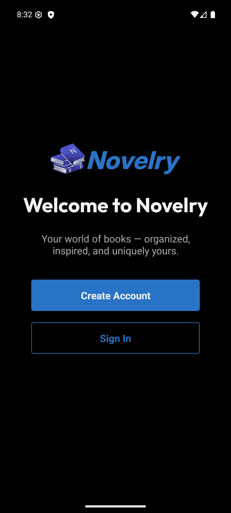
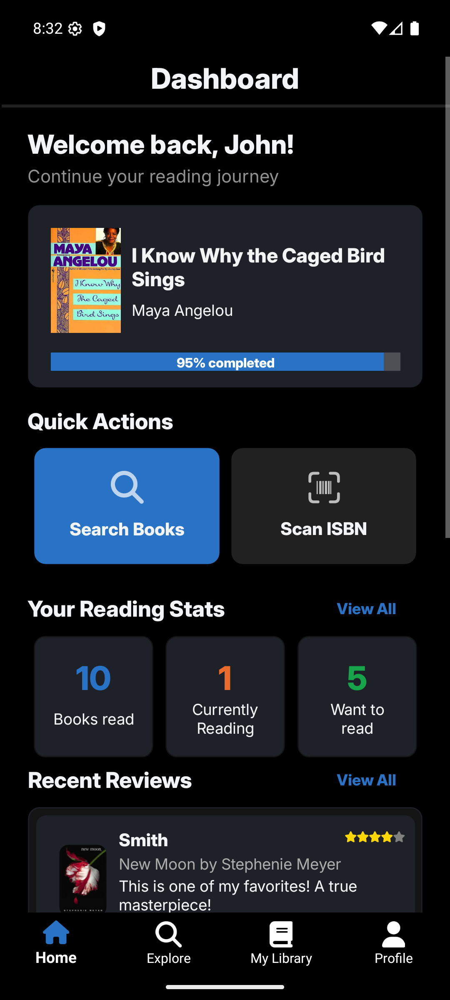
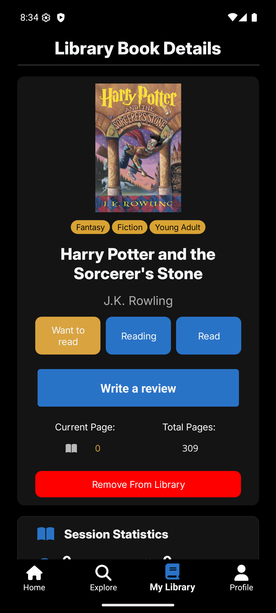
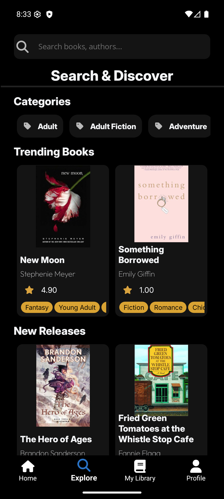
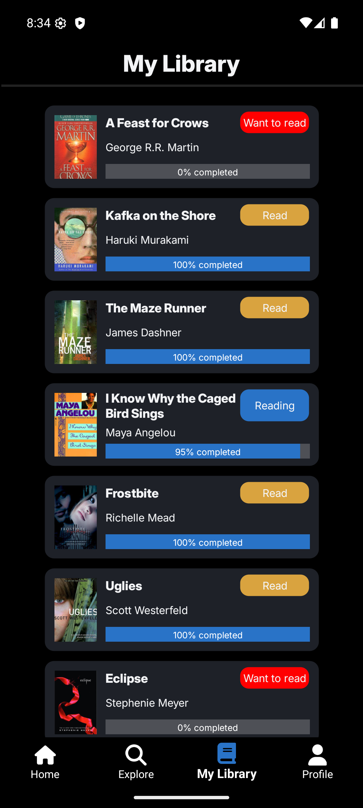

<p align="center"></p>

# Novelry

A personal reading companion. Track what you read, set goals, time your reading sessions and get recommendations that explain themselves. No social feed and no pressure, just your own reading.

> **Status: being rebuilt for the App Store and Google Play.**
> The original .NET MAUI prototype is being replaced by a local-first React Native app. Progress is tracked in the [GitHub issues](https://github.com/LorenzoLatinne/Novelry/issues/2).

## Features

Done:
- On-device storage with versioned migrations (your data stays on your phone)
- Search books by title or author (powered by [Open Library](https://openlibrary.org)) on the Explore tab
- Book detail screen with *Add to Library*; added Books are saved on the device and show offline
- Your Library lists the books you added, filterable by shelf and searchable by title or author
- Scan a book's ISBN barcode with the camera (or type the ISBN); the camera is used only for scanning and nothing is recorded

Planned (see [issue #2](https://github.com/LorenzoLatinne/Novelry/issues/2)):
- Moving books between the shelves *Want to read*, *Reading* and *Read*
- Reading sessions with a timer, reviews and ratings
- Reading goals (books per year, minutes per day) and achievements
- Transparent on-device recommendations ("because you read …")
- Export and import your data as a single file, to move between phones

## Principles

- **Local-first**: no account needed, your data lives on your device ([ADR-0001](docs/adr/0001-local-first-no-accounts.md)).
- **Open data**: books and covers come from Open Library ([ADR-0002](docs/adr/0002-open-library-as-book-source.md)).
- **Free**: no ads, no in-app purchases.

## Tech stack

- React Native with [Expo](https://expo.dev) and TypeScript ([ADR-0003](docs/adr/0003-react-native-expo-for-the-app.md))
- SQLite on the device (`expo-sqlite`)
- Jest for tests, run against real in-memory SQLite

## Getting started

Requirements: Node.js 22.5 or later, and the Expo Go app on your phone (or an iOS/Android simulator).

```bash
cd NovelryApp
npm install
npx expo start
```

Scan the QR code with Expo Go to run the app on your phone.

## Tests

```bash
cd NovelryApp
npm test            # Jest
npm run typecheck   # TypeScript
```

## Project structure

| Path | What it is |
| --- | --- |
| `NovelryApp/` | The Expo app. `src/core` holds all UI-independent logic (storage, catalog), `src/ui` the screens |
| `GLOSSARY.md` | The vocabulary of the project (Library, Shelf, Reading Session, …) |
| `docs/adr/` | Architecture decision records |
| `NovelryMAUIApp/` | The original .NET MAUI prototype, kept as reference until the new app has parity |
| `NovelryWebAPI/`, `NovelryDTO/` | The prototype backend. Not shipped; kept as a possible future sync layer |

## Prototype screenshots (.NET MAUI)

<div style="display: flex; flex-wrap: wrap; gap: 10px;">
  
  
  
  
  
</div>

## Credits

- Book data and covers: [Open Library](https://openlibrary.org)
- Prototype: icons by [aathifmahir](https://www.nuget.org/packages/AathifMahir.Maui.MauiIcons.FontAwesome), ISBN scanning by [ZXing.Net.Maui](https://www.nuget.org/packages/ZXing.Net.Maui.Controls), password hashing by [BCrypt.Net](https://www.nuget.org/packages/BCrypt.Net-Next)

## License

MIT, see [LICENSE](LICENSE).
